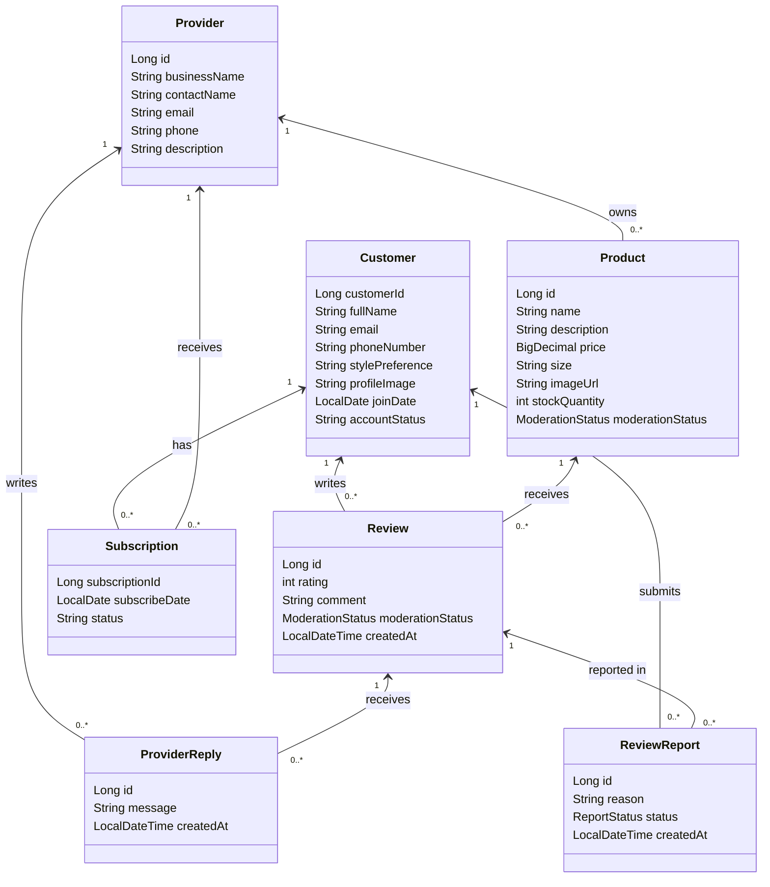

# Fit District — Backend API

## Project Overview

Fit District is a clothing marketplace application where customers can discover products from multiple providers, manage their profiles, and subscribe to clothing providers. The backend is built using Java 21, Spring Boot, Spring Data JPA, and PostgreSQL.

The application uses Neon PostgreSQL for data persistence and is deployed to Render using Docker.

## Live Render Deployment

**Live API URL:** https://fit-district-api.onrender.com

The API is deployed using Docker on Render.

**Cold Start Note:** Render's free instance may spin down after inactivity. The first API request may take a minute or longer to respond.

This application is a REST API, so the root URL may return 404. Use the documented API endpoints.

## Customer and Subscription API

**Implemented by:** Cameron Wilkerson

| HTTP Method | Endpoint | Description / Use Case | Success Status | Implemented By |
|---|---|---|---|---|
| POST | `/api/customers` | Create customer profile | 201 Created | Cameron Wilkerson |
| GET | `/api/customers/{id}` | View customer profile | 200 OK | Cameron Wilkerson |
| PUT | `/api/customers/{id}` | Modify customer profile | 200 OK | Cameron Wilkerson |
| DELETE | `/api/customers/{id}` | Delete customer profile | 204 No Content | Cameron Wilkerson |
| POST | `/api/customers/{customerId}/subscriptions` | Subscribe to a clothing provider | 201 Created | Cameron Wilkerson |
| GET | `/api/customers/{customerId}/subscriptions` | View customer subscriptions | 200 OK | Cameron Wilkerson |
| DELETE | `/api/subscriptions/{id}` | Delete customer subscription | 204 No Content | Cameron Wilkerson |

### Example Request: Create Customer

**POST** `/api/customers`

```json
{
  "fullName": "Test Customer",
  "email": "testcustomer@example.com",
  "phoneNumber": "3365550123",
  "stylePreference": "Streetwear"
}
```

**Expected success status:** 201 Created

### Example Request: Update Customer

**PUT** `/api/customers/1`

```json
{
  "fullName": "Updated Customer",
  "email": "updatedcustomer@example.com",
  "phoneNumber": "3365550123",
  "stylePreference": "Casual"
}
```

**Expected success status:** 200 OK

### Example Request: Subscribe to Provider

**POST** `/api/customers/1/subscriptions`

```json
{
  "providerId": 3
}
```

**Expected success status:** 201 Created

## Customer API Error Handling

| HTTP Status | Meaning |
|---|---|
| 200 OK | Resource successfully retrieved or updated |
| 201 Created | Customer or subscription created |
| 204 No Content | Resource deleted |
| 400 Bad Request | Invalid customer input |
| 401 Unauthorized | Missing or incorrect authentication |
| 404 Not Found | Requested customer does not exist |
| 409 Conflict | Duplicate subscription attempt |

These HTTP responses were tested using EchoAPI against the deployed Render application.

## Authentication

The API uses HTTP Basic Authentication for protected endpoints. Authentication credentials are stored privately in Render environment variables and are not included in this repository.

## Provider and System Administrator APIs

## Provider and System Administrator APIs

**Implemented by:** Ronald Hester Jr.

### Provider Profile API

| HTTP Method | Endpoint | Description / Use Case | Success Status | Implemented By |
|---|---|---|---|---|
| POST | `/api/providers` | Create provider profile | 201 Created | Ronald Hester Jr. |
| GET | `/api/providers` | View all providers | 200 OK | Ronald Hester Jr. |
| GET | `/api/providers/{id}` | View provider profile | 200 OK | Ronald Hester Jr. |
| PUT | `/api/providers/{id}` | Update provider profile | 200 OK | Ronald Hester Jr. |
| DELETE | `/api/providers/{id}` | Delete provider profile | 204 No Content | Ronald Hester Jr. |

### Product Management API

| HTTP Method | Endpoint | Description / Use Case | Success Status | Implemented By |
|---|---|---|---|---|
| POST | `/api/products/provider/{providerId}` | Create product for a provider | 201 Created | Ronald Hester Jr. |
| GET | `/api/products` | View all products | 200 OK | Ronald Hester Jr. |
| GET | `/api/products/{id}` | View product details | 200 OK | Ronald Hester Jr. |
| GET | `/api/products/provider/{providerId}` | View provider products | 200 OK | Ronald Hester Jr. |
| PUT | `/api/products/{id}` | Update product details and inventory | 200 OK | Ronald Hester Jr. |
| DELETE | `/api/products/{id}` | Delete product | 204 No Content | Ronald Hester Jr. |

### Provider Activity and Replies

| HTTP Method | Endpoint | Description / Use Case | Success Status | Implemented By |
|---|---|---|---|---|
| GET | `/api/providers/{providerId}/customer-activity` | View approved review activity on provider products | 200 OK | Ronald Hester Jr. |
| POST | `/api/provider-replies/provider/{providerId}/review/{reviewId}` | Reply to an approved review on own product | 201 Created | Ronald Hester Jr. |
| GET | `/api/provider-replies/review/{reviewId}` | View replies to a review | 200 OK | Ronald Hester Jr. |
| GET | `/api/provider-replies/provider/{providerId}` | View provider replies | 200 OK | Ronald Hester Jr. |

### Review and Report API

| HTTP Method | Endpoint | Description / Use Case | Success Status | Implemented By |
|---|---|---|---|---|
| POST | `/api/reviews/customer/{customerId}/product/{productId}` | Submit product review | 201 Created | Ronald Hester Jr. |
| GET | `/api/reviews/product/{productId}` | View approved product reviews | 200 OK | Ronald Hester Jr. |
| POST | `/api/review-reports/customer/{customerId}/review/{reviewId}` | Report a review | 201 Created | Ronald Hester Jr. |

### System Administrator: Customer Accounts

| HTTP Method | Endpoint | Description / Use Case | Success Status | Implemented By |
|---|---|---|---|---|
| GET | `/api/admin/customers` | View customer accounts | 200 OK | Ronald Hester Jr. |
| GET | `/api/admin/customers/{id}` | View customer account | 200 OK | Ronald Hester Jr. |
| PUT | `/api/admin/customers/{id}/suspend` | Suspend customer account | 200 OK | Ronald Hester Jr. |
| PUT | `/api/admin/customers/{id}/activate` | Activate customer account | 200 OK | Ronald Hester Jr. |

### System Administrator: Product Moderation

| HTTP Method | Endpoint | Description / Use Case | Success Status | Implemented By |
|---|---|---|---|---|
| GET | `/api/admin/products/pending` | View products awaiting moderation | 200 OK | Ronald Hester Jr. |
| PUT | `/api/admin/products/{id}/approve` | Approve product | 200 OK | Ronald Hester Jr. |
| PUT | `/api/admin/products/{id}/reject` | Reject product | 200 OK | Ronald Hester Jr. |

### System Administrator: Reviews and Reports

| HTTP Method | Endpoint | Description / Use Case | Success Status | Implemented By |
|---|---|---|---|---|
| GET | `/api/admin/reviews` | View all reviews | 200 OK | Ronald Hester Jr. |
| GET | `/api/admin/reviews/pending` | View pending reviews | 200 OK | Ronald Hester Jr. |
| GET | `/api/admin/reviews/{id}` | View review details | 200 OK | Ronald Hester Jr. |
| PUT | `/api/admin/reviews/{id}/approve` | Approve review | 200 OK | Ronald Hester Jr. |
| PUT | `/api/admin/reviews/{id}/remove` | Soft-remove review | 200 OK | Ronald Hester Jr. |
| GET | `/api/admin/review-reports` | View all review reports | 200 OK | Ronald Hester Jr. |
| GET | `/api/admin/review-reports/pending` | View pending reports | 200 OK | Ronald Hester Jr. |
| GET | `/api/admin/review-reports/{id}` | View report details | 200 OK | Ronald Hester Jr. |
| PUT | `/api/admin/review-reports/{id}/resolve` | Resolve report | 200 OK | Ronald Hester Jr. |
| PUT | `/api/admin/review-reports/{id}/dismiss` | Dismiss report | 200 OK | Ronald Hester Jr. |

### System Administrator: Statistics

| HTTP Method | Endpoint | Description / Use Case | Success Status | Implemented By |
|---|---|---|---|---|
| GET | `/api/admin/statistics` | View provider counts and product moderation counts | 200 OK | Ronald Hester Jr. |

### Example Request: Create Provider

**POST** `/api/providers`

{
  "businessName": "FIT DI$TRICT Athletics",
  "contactName": "Test Provider",
  "email": "athletics@example.com",
  "phone": "3365550100",
  "description": "Premium athletic apparel and accessories"
}

**Expected success status:** 201 Created

### Example Request: Update Provider

**PUT** `/api/providers/2`

{
  "businessName": "FIT DI$TRICT Athletics",
  "contactName": "Updated Provider",
  "email": "athletics@example.com",
  "phone": "3365550100",
  "description": "Updated athletic apparel and streetwear collection"
}

**Expected success status:** 200 OK

### Example Request: Create Product

**POST** `/api/products/provider/2`

{
  "name": "FIT DI$TRICT Black Hoodie",
  "description": "Comfortable athletic hoodie",
  "price": 49.99,
  "size": "L",
  "imageUrl": "https://example.com/hoodie.jpg",
  "stockQuantity": 25
}

**Expected success status:** 201 Created

### Example Request: Update Product

**PUT** `/api/products/1`

{
  "name": "FIT DI$TRICT Black Hoodie",
  "description": "Updated heavyweight athletic hoodie",
  "price": 75.00,
  "size": "L",
  "imageUrl": "https://example.com/hoodie.jpg",
  "stockQuantity": 40
}

**Expected success status:** 200 OK

### Example Request: Submit Review

**POST** `/api/reviews/customer/1/product/1`

{
  "rating": 4,
  "comment": "Comfortable material and a great fit."
}

**Expected success status:** 201 Created

Reviews begin with moderation status `PENDING`.

### Example Request: Reply to Review

**POST** `/api/provider-replies/provider/2/review/1`

{
  "message": "Thank you for your feedback! We appreciate your support."
}

**Expected success status:** 201 Created

The review must be approved and belong to the provider's product.

### Example Request: Report Review

**POST** `/api/review-reports/customer/1/review/1`

{
  "reason": "This review contains misleading information."
}

**Expected success status:** 201 Created

Reports begin with status `PENDING`.

### Example Request: Approve Product

**PUT** `/api/admin/products/1/approve`

**Request body:** None.

**Expected success status:** 200 OK

### Example Request: Resolve Review Report

**PUT** `/api/admin/review-reports/1/resolve`

**Request body:** None.

**Expected success status:** 200 OK

All administrator action endpoints listed above use PUT and require no request body. Replace example IDs with existing database records.

### Provider and System Administrator Error Handling

| HTTP Status | Meaning |
|---|---|
| 200 OK | Resource retrieved, updated, or moderated |
| 201 Created | Resource created |
| 204 No Content | Resource deleted |
| 400 Bad Request | Invalid input |
| 401 Unauthorized | Missing or incorrect authentication |
| 403 Forbidden | Insufficient permissions or failed provider ownership check |
| 404 Not Found | Requested resource does not exist |
| 409 Conflict | Conflicting request, such as a duplicate provider reply |

### Provider and Administrator Authentication

System Administrator endpoints require HTTP Basic Authentication with the ADMIN role. Protected provider features enforce provider identity and ownership where applicable. Credentials are stored privately in environment variables.

### Implemented User Stories

| User Story | Description | Implemented By |
|---|---|---|
| US-23 | View customer activity on provider products | Ronald Hester Jr. |
| US-24 | Reply to approved customer reviews | Ronald Hester Jr. |
| US-30 | Manage customer account status | Ronald Hester Jr. |
| US-31 | Moderate product listings | Ronald Hester Jr. |
| US-32 | Moderate reviews and handle review reports | Ronald Hester Jr. |
| US-33 | View application statistics | Ronald Hester Jr. |

## UML Class Diagram



Each product belongs to one provider. Each review belongs to one customer and one product. Provider replies link a provider to a review, and review reports link a customer to a reported review. Each subscription links one customer to one provider.

`1` means exactly one, and `0..*` means zero or more. The service layer enforces the rule allowing only one provider reply per review.

## GitHub Issues and User Stories

*The team will add links to the GitHub issues associated with the implemented use cases.*
